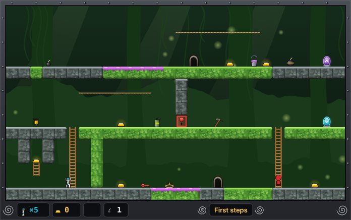
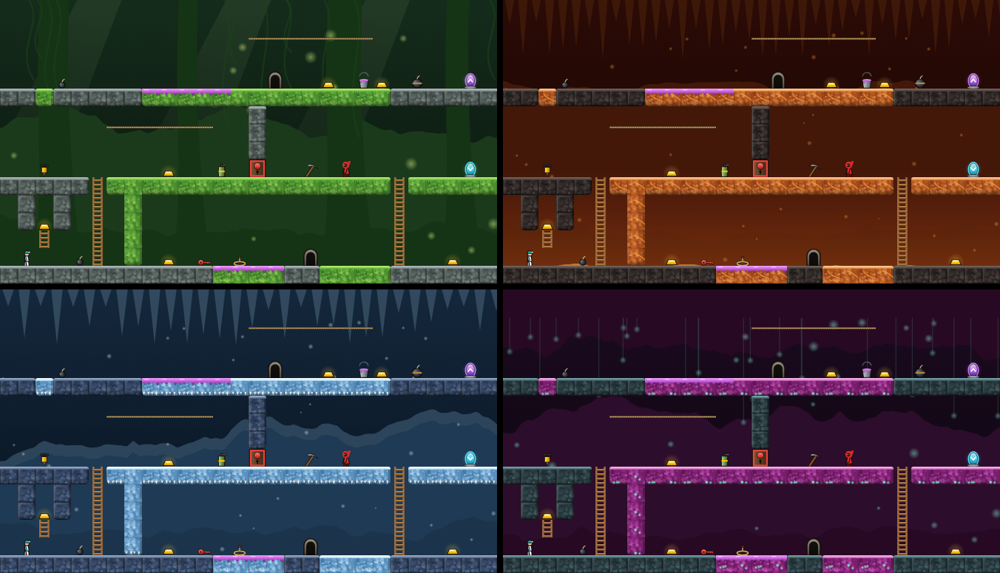
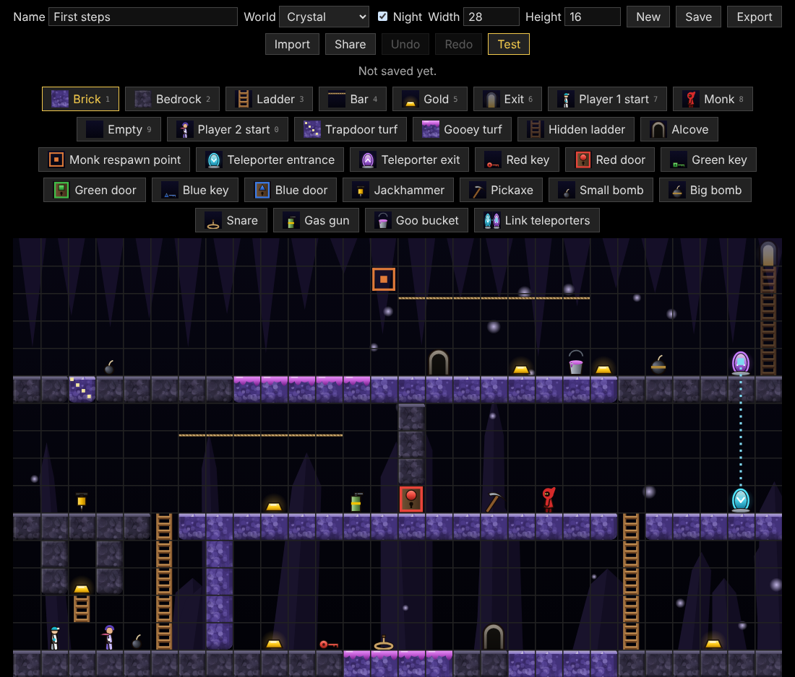

# Return of the Runners

An unofficial browser fan remake of _Lode Runner: The Legend Returns_ (Presage/Sierra,
1994): dig, grab the gold, dodge the monks, and build your own levels with the built-in
editor. 1–2 players on one keyboard.

**▶ Play in your browser:** https://guillaumedd.github.io/return-of-the-runners/
(no install, no account; keyboard needed)



## What's in it

- **The Legend Returns rules:** dig holes to trap the monks, grab all the gold and
  reach the exit. Trapdoors, gooey turf, alcoves to hide in, teleporters, keys and
  doors.
- **Tools:** jackhammer, pickaxe, small and big bombs, snares, gas gun, goo bucket.
- **Two players on one keyboard,** in co-op or versus.
- **Ten worlds,** each by day and by night, with art drawn entirely in code.
- **A level editor:** paint a level, test it at once, save it in the browser, export
  it as a file, or share it as a link.
- English and French.





> Status: in development. Rules, tools, two players, worlds and the editor are
> playable; music, level packs and menus come next. See the
> [roadmap](docs/PRD.md#7-roadmap).

## Development

Requires Node.js 22 (see `.nvmrc`).

```sh
npm ci            # install exact locked dependencies
npm run dev       # local dev server
npm run typecheck && npm run lint && npm test   # must pass before each commit
npm run build     # production build in dist/
npm run e2e       # replays in real browsers (first: npx playwright install chromium firefox webkit)
```

## Documents

- [Product requirements](docs/PRD.md)
- [Architecture](docs/ARCHITECTURE.md)
- [Backlog](docs/BACKLOG.md)
- [Asset provenance](ASSETS.md)
- [Contributor and agent rules](CLAUDE.md)

## License

- Code: [GPL-3.0-or-later](LICENSE).
- Project assets and levels: [CC BY-SA 4.0](https://creativecommons.org/licenses/by-sa/4.0/).

This is a non-commercial fan project, not affiliated with or endorsed by the owners
of _Lode Runner_. No original game assets or data are included.
