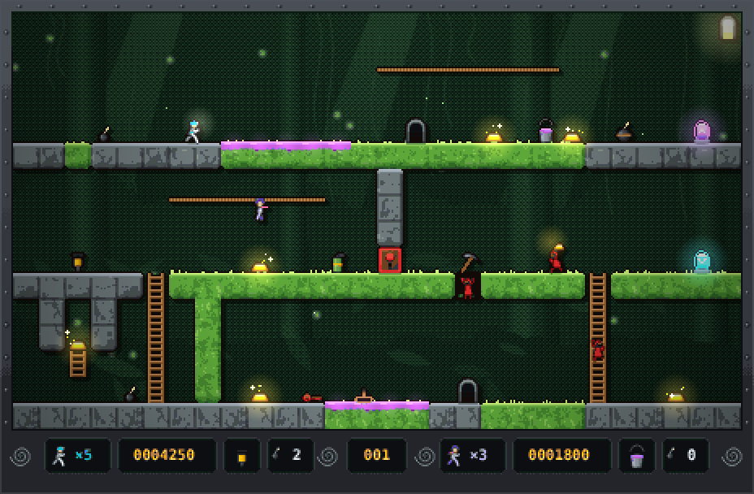
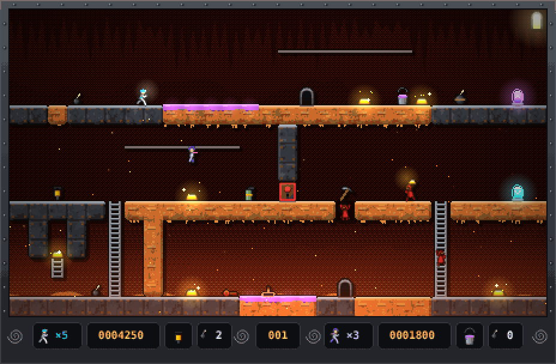
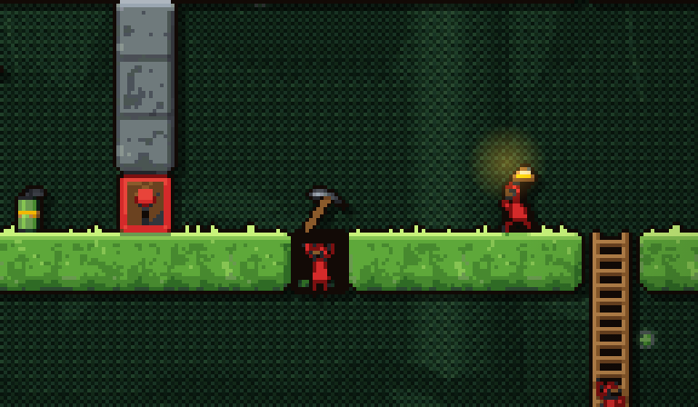
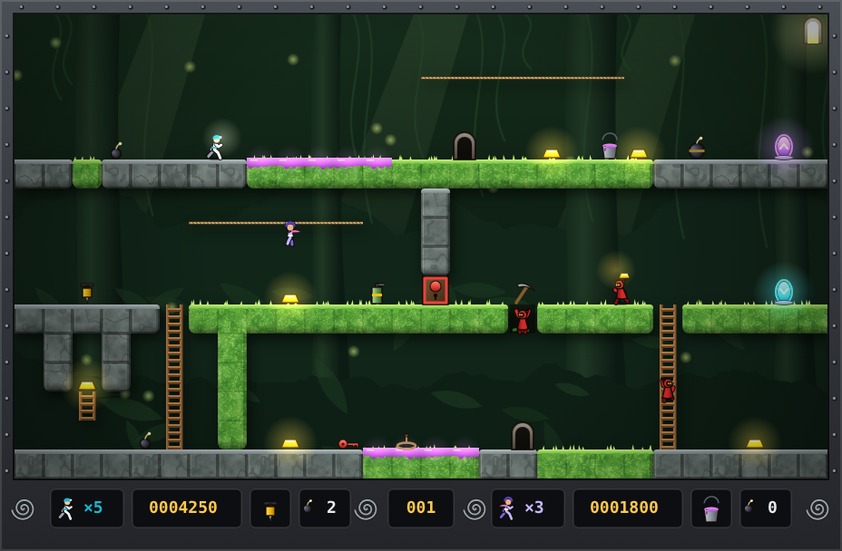
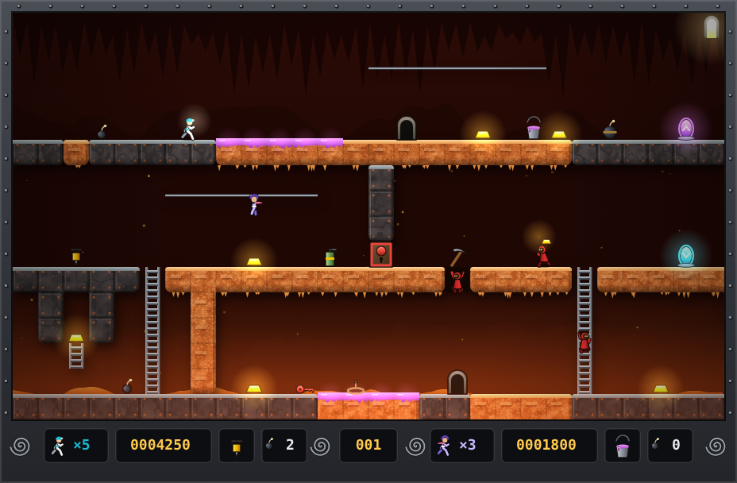
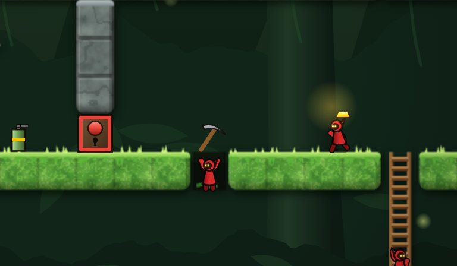
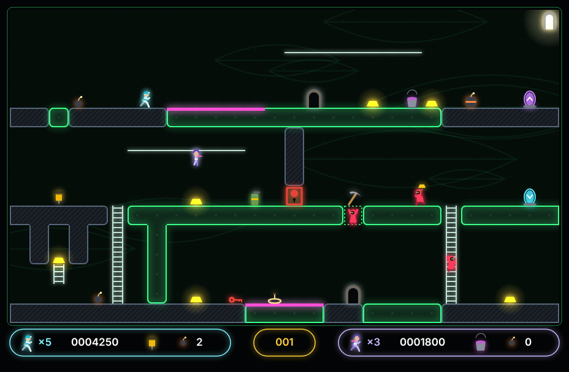
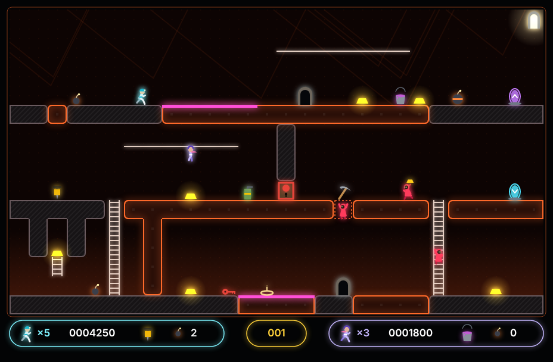
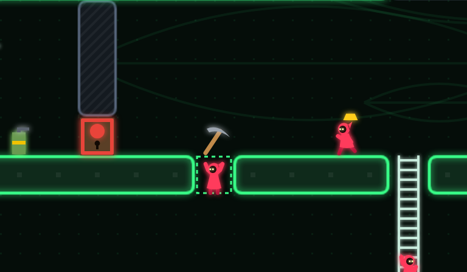

# Step 4 plan, part A: the look (art direction, sprites, worlds)

Status: **approved**; direction chosen by Guillaume on 2026-10-30: the illustrated
diorama (B-030, style guide in ARCHITECTURE § Art direction). Roadmap: `docs/PRD.md` §7, step 4.
Backlog items: B-030 to B-036. Source ids (`S-…`) refer to [`../SOURCES.md`](../SOURCES.md).

## Goal

Replace the placeholder shapes with recreated art that keeps the spirit of _The Legend
Returns_ (its ten worlds, painted backdrops, chunky terrain, tiny readable runners and
monks) but looks like a game made in 2026–27: smooth animation, light, particles,
crisp on any screen. Guillaume picks the direction from mockups before any production
art is drawn.

Nothing is extracted or traced from the original game (CLAUDE.md, PRD § Content and
licensing). The videos are a reference for mood, palette and readability only; every
asset is drawn for this project and listed in `ASSETS.md`.

**Part B** of step 4 (music, level packs, menus, scores, remappable keys, gamepads)
is planned later, in its own PR.

## Why a step 4 plan, and why now

- Step 3 already put "world tile sets and art" out of scope, in step 4 (`step-3.md`).
- Production art waits for step 3 to end (B-028): drawing each element once, after its
  rules exist, avoids redrawing terrain and tools as their behavior is settled.
- The direction itself (B-030) touches no code and can be done at any time, in
  parallel with step 3, without delaying B-021 (versus), which stays next.

## What TLR looks like (S-014, S-016, S-018, S-021, S-024)

Observed on frames of the PC version (640 × 480, 256 colours, S-003):

| Trait            | What the videos show                                                                                                                    | Sources                    |
| ---------------- | --------------------------------------------------------------------------------------------------------------------------------------- | -------------------------- |
| One look a world | Each world has its own terrain texture and colour: green moss slabs, orange lava brick, pale blue ice with icicles, purple crystal rock | S-014, S-016, S-018, S-021 |
| Painted backdrop | A dim, painted scene behind the grid (jungle, lava cave, ice cavern, machinery) that never competes with the terrain                    | S-014, S-016, S-018, S-024 |
| Terrain blocks   | Diggable blocks read as rounded, textured slabs with a lit top edge; bedrock and metal look heavier                                     | S-014, S-024               |
| Small actors     | Runners and monks are tiny (about half a tile wide); monks are red, which keeps them readable on every backdrop                         | S-014, S-018               |
| Items glow       | Gold is a bright yellow bar, the brightest thing on screen; tools and keys are small icons on the floor                                 | S-014, S-016, S-021        |
| Frame and HUD    | A riveted stone and metal frame around the level; a status bar at the bottom with carved spiral ornaments, lives, score, level, slot    | S-014, S-016               |

What we keep: one identity per world, a calm backdrop behind loud terrain, gold as the
brightest thing, monks that pop out in one glance, a framed playfield with a status bar.

## Mood board (B-030)

Frames watched on 2026-10-30 for B-030, kept out of the repo like the videos. What each
shows, in words:

| Frame        | World      | What it shows                                                                                                                              |
| ------------ | ---------- | ------------------------------------------------------------------------------------------------------------------------------------------ |
| S-014 @ 1:00 | Moss       | Bright green moss slabs, a lighter top edge, darker inside; a dark hand-inked jungle behind (ferns, vines, trunks) in olive and brown      |
| S-014 @ 3:00 | Moss       | Tiny white runner, red monks: both read at once on the busy backdrop; gold as small yellow bars that glow in the dark pockets of the slabs |
| S-014 @ 5:30 | Moss       | Grey stone slabs with rounded ends next to the moss, and an orange turf dripping like wax                                                  |
| S-016 @ 2:00 | Lava       | Orange porous rock with brick insets and yellow drips under each ledge; a painted red and orange lava flow behind; grey ladders and bars   |
| S-018 @ 0:10 | Ice        | Pale blue ice blocks hung with icicles over a blue ice cavern painted in broad strokes                                                     |
| S-021 @ 0:55 | Phosphorus | Magenta crystal slabs, teal liquid pools, a dark purple veined backdrop                                                                    |
| S-024 @ 1:00 | Industrial | Grey riveted machine blocks with hazard stripes on a sepia backdrop of machinery                                                           |
| S-014 @ 1:00 | (all)      | A dark riveted metal frame; the status bar: carved spirals between panels for lives, score, level and the item slot                        |

The lesson: terrain is the loudest layer and the backdrop the calmest, actors are tiny
but never lost (white runner, red monks), gold glows, and each world owns one colour.

## Three directions to mock up (B-030)

Each direction is mocked on the same level (`first-steps`) in two worlds (Moss and Lava),
so they compare like for like.

1. **Neo-pixel.** Pixel art at a higher resolution than 1994 (about 32 px tiles),
   a limited palette per world, plus what 1994 could not do: dynamic 2D light (gold,
   lava and phosphorus glow), soft shadows, particles, smooth 60 fps animation. The
   closest to TLR's soul, and the most work to draw by hand.
2. **Illustrated diorama.** Vector-drawn tiles and actors with gradients and soft
   shading, layered parallax backdrops that echo TLR's painted scenes, rendered at the
   screen's own resolution. The modern "hand-painted indie" look, and the easiest to
   author in this repo (SVG source, tweakable by anyone).
3. **Bold flat glow.** Clean geometric shapes, strong silhouettes, dark backdrops and
   neon accents. The most readable and the quickest to produce, but the furthest from
   TLR.

Leaning before the mockups: **2**, with direction 1's light and particles. It keeps the
painted feel of TLR, scales to any screen, and can be drawn and maintained in code
review. Guillaume chose it on the mockups on 2026-10-30.

Common to all three, because it is what "modern" means in 2026–27 beyond the style:

- crisp on high-DPI screens (render at `devicePixelRatio`, no blurry upscaling);
- animation driven by state and time, eased, never jerky;
- readability first: runners, monks and items read in one glance on every world;
  keys and doors differ by **shape and colour**, never colour alone;
- juice with restraint: small particles, light flashes, a light screen shake on big
  bombs, all off when the system asks for reduced motion (`prefers-reduced-motion`).

## The mockups (B-030)

Drawn on 2026-10-30, entirely in code (`tools/mockup/`, nothing traced or extracted):
the same scene of `first-steps` in each direction and world, with both runners, a monk
trapped in a hole, one carrying gold and one climbing. Each picture is 928 × 608 at
device pixel ratio 1; the close-ups are the middle of the Moss level at ratio 2.
`node tools/mockup/render.ts` redraws them all.

| Direction    | Moss                                                    | Lava                                                    | Close-up                                                      |
| ------------ | ------------------------------------------------------- | ------------------------------------------------------- | ------------------------------------------------------------- |
| 1. Neo-pixel |  |  |  |
| 2. Diorama   |  |  |  |
| 3. Flat glow |   |   |   |

How each was made, and what that says about producing it:

- **Neo-pixel** is the diorama drawn at 16 px a tile, snapped to a palette of about 50
  colours (ordered dithering on the backdrop, a dark outline around sprites), scaled ×2
  without smoothing, then lit with smooth light and pixel sparks. Terrain and items hold
  up; the actors are muddy, because 16 px sprites need drawing pixel by pixel by hand.
  Choosing this direction means hand-made sprite sheets for every animation.
- **Diorama** draws vectors with gradients and procedural textures (seeded noise), a
  layered backdrop with light shafts or a lava river, a drop shadow under the terrain,
  additive light on gold, the exit and portals, and a vignette. Crisp at any ratio, and
  every shape is code a PR can review.
- **Flat glow** uses flat fills with a neon rim, a dot grid and faint outlines as the
  backdrop. The most readable, the cheapest, but the painted mood of TLR is gone.

Choices common to the three, to confirm with the direction: runner 1 is white with a
cyan helmet and a lamp, runner 2 lavender with a pink scarf (silhouette and colour);
monks are red hooded robes with glowing eyes; goo is magenta in every world (TLR's
looks orange, S-014 @ 5:30: ours must not be mistaken for lava); keys and doors
differ by shape (circle red, square green, triangle blue); the entrance teleporter is
cyan with an arrow in, the exit violet with an arrow out; the status bar stays at the
bottom, as in TLR (open question 1).

## Key design decisions

- **Who draws** (Guillaume, 2026-10-28). By default the art is written as code: SVG
  shapes and procedural textures (seeded noise for moss, lava, frost) in the repo,
  rasterized at load or at build, reviewed in PRs like code. The heroes may be touched
  up by hand. A third-party pack may help only if its license is CC0, CC BY, CC BY-SA
  or GPL-compatible (ASSETS.md).
- **Fallback: generated images.** If the code-drawn art does not convince, images from
  generative AI are allowed, on one condition: each one passes a **similarity check**
  before it is committed. The check compares it with the original game's frames (from
  the S-014 to S-026 files, kept out of the repo) using a perceptual hash and an image
  embedding distance, rejects anything above a threshold set in B-030, and adds a
  reverse image search to catch other licensed images. The tool, model and prompt of
  each image are recorded in its `ASSETS.md` entry. No check proves the absence of
  every licensed lookalike; it catches the close ones.
- **The simulation stays untouched.** Art is a renderer concern: no new state, no
  timing change. Every replay fixture keeps its hash (the B-010 suite is the proof).
- **Animation clock.** Sprites pick their frame from the simulation state (action,
  facing, progress in the tick) and the render frame's time; nothing feeds back into
  the simulation.
- **Worlds are level data.** A level names its world (and day or night, an option of
  TLR's editor, S-001): this changes the level format, so B-035 ships format v3 with a
  v2 → v3 migration and fixtures (ARCHITECTURE § Level format).
- **CSP unchanged.** Images are served from `'self'`; no web fonts or CDNs at runtime.
- **Placeholders stay as a fallback** while the art lands, so every item is playable at
  every commit.

## Delivery: one PR per backlog item

| Order | PR                    | Backlog | Visible result                                            | When                 |
| ----- | --------------------- | ------- | --------------------------------------------------------- | -------------------- |
| 1     | Art direction         | B-030   | three mockups; Guillaume picks one; a style guide         | any time (no code)   |
| 2     | Sprite renderer       | B-031   | none yet (placeholders drawn through the new pipeline)    | after step 3 (B-028) |
| 3     | Runners and monks     | B-032   | **animated runners and monks**                            | after B-031          |
| 4     | Terrain and items     | B-033   | **the Moss world**: every tile and item drawn             | after B-031          |
| 5     | Effects               | B-034   | digging dust, gold sparkle, blasts, gas, teleport flashes | after B-032, B-033   |
| 6     | Worlds and day/night  | B-035   | **ten worlds**, chosen per level in the editor            | after B-033          |
| 7     | Frame, HUD and editor | B-036   | the framed playfield, status bar and editor palette       | after B-033          |

Every visible change comes with a screenshot linked by commit SHA, every asset gets
its `ASSETS.md` entry in the same PR, and every UI string lands in EN and FR.

## Modules and enumerated tests

### B-030 — Art direction

- A mood board described in words, with S-id timestamps (frames of the original stay
  out of the repo, like the videos).
- Three static mockups (above), made for this project, in `docs/screenshots/` with
  their `ASSETS.md` entries.
- Once Guillaume picks: a style guide in ARCHITECTURE § Art direction (tile and actor
  sizes, palette per world, outline and light rules, animation list and frame counts,
  reduced-motion rules), and this plan's status set to approved.

No code, no tests. Acceptance: Guillaume has chosen a direction in the PR. If he
turns down the code-drawn art for generated images, B-030 also delivers the similarity
check (a script with its threshold and its tests) before the first generated image.

### B-031 — Sprite renderer

- `src/render/sprites.ts`: draws the sprite sheets in code at load (no image request),
  maps each tile and actor state to a sprite and frame; falls back to the placeholder
  shape for anything not drawn yet.
- `src/render/scale.ts`: canvas backing store at `devicePixelRatio`, integer scaling
  where the style needs it.

`tests/render/sprites.test.ts`: every tile character of the format has a sprite or a
placeholder (the list is checked against `format.ts`, so a new tile without art fails);
an actor's frame depends only on its state and the given time; a missing sheet falls
back to placeholders without throwing.

`tests/render/scale.test.ts`: canvas size for DPR 1, 1.5, 2 and 3; no fractional
backing-store size.

Replay suite: all fixtures keep their hash (the renderer never touches the state).

### B-032 — Runners and monks

- Runner 1 and runner 2 differ by silhouette and colour; monks stay the loudest colour
  on screen. Animations: idle, run, climb, hand-over-hand on bars, fall, dig left and
  right, die, respawn; monks also: trapped in a hole, climbing out, carrying gold,
  snared, dazed.

`tests/render/actors.test.ts`: each simulation action maps to one animation; the frame
index loops within the animation's length; facing flips the sprite, not the frame list.

### B-033 — Terrain and items (Moss world)

- Every tile of format v2 and every item of step 3: brick, bedrock, ladder, bar, gold,
  trapdoor turf, gooey turf, hidden ladder (when shown), alcove, teleporters, keys and
  doors (three shapes and colours), tools, bombs, snare, exit.
- Brick shows its dig and refill stages (hole timers already in the state).

`tests/render/tiles.test.ts`: hole stage → sprite frame for each refill stage; a
trapdoor looks like brick in play and is marked in the editor; keys and doors of
different colours use different shapes.

### B-034 — Effects

- Particles and light: digging dust, refill, gold pickup sparkle, exit appearing,
  small and big blasts (with a light shake), gas cloud, teleport flash, death.
- `src/render/effects.ts` reads events from the state diff between two frames; effects
  are purely visual and capped in number.
- Reduced motion: no shake, fewer particles, no flashes.

`tests/render/effects.test.ts`: each event starts its effect once; effects expire; the
cap holds under a burst (randomized: 1,000 random event bursts never exceed it);
`prefers-reduced-motion` turns off shake and flashes.

### B-035 — Worlds and day/night

- Ten worlds (Moss, Fungus, Ancient, Crystal, Ice, Fossil, Lava, Phosphorus, Dark,
  Industrial, S-010 titles), each with a terrain set and a backdrop; a night variant.
- Level format v3: `world` and `night` fields; migration v2 → v3 (default Moss, day);
  editor picker for both, translated.

`tests/level/format-v3.test.ts`: v2 fixtures migrate to v3 with defaults; unknown world
rejected with a translated error; fixtures per new error code; fuzz test extended to v3.
`tests/render/worlds.test.ts`: every world has every tile sprite (no fallback left).

### B-036 — Frame, HUD and editor

- A framed playfield and bottom status bar in the chosen style (lives, score, level,
  item slot, bomb counter, per player); the editor palette shows the real art.

`tests/game/hud.test.ts` (extended): both players' slots and counters are drawn from
the state; every label is translated (EN + FR).

## Open questions

1. **Resolution**: keep TLR's 4:3 frame around the 28 × 16 grid, or a 16:9 layout with
   the HUD on the side? To settle with the mockups.
2. **Hero names and looks** (PRD § Open questions): the runners' design needs them.
